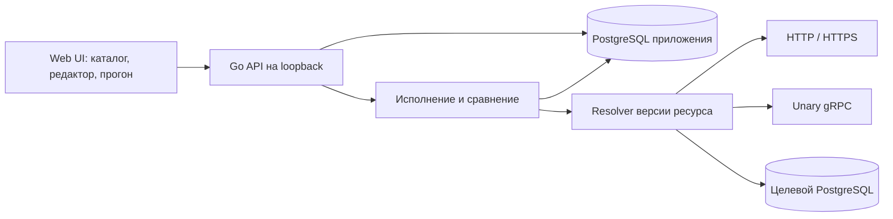

## Context

В репозитории обнаружены только `README.md`, `LICENSE` и `.gitignore`; прикладного кода, API, миграций и тестов нет. OpenSpec инициализирован со схемой `spec-driven`. Мотивация и функциональные границы описаны в [proposal.md](proposal.md), наблюдаемое поведение — в семи delta specs под `specs/`.

Подтверждённые ограничения: Go + TypeScript, один локальный пользователь без авторизации, PostgreSQL для данных приложения и SQL-целей. История автоматически закрепляет первый завершённый и первый успешный прогон; последующие можно закреплять вручную.

## Goals / Non-Goals

**Goals:**

- Один собираемый Go-процесс с браузерным UI, одним постоянным PostgreSQL-хранилищем и отдельными исполнителями протоколов.
- Единая модель результата и сравнения для ручного прохождения и пробного запуска блока.
- Устойчивые снимки сценария и версий ресурсов, атомарное закрепление первых прогонов, отсутствие автоматического повторения внешних действий.
- Проверяемые контракты API и независимые интеграционные стенды без доступа к рабочим ресурсам пользователя.

**Non-Goals:**

- Распределённые исполнители, очередь сообщений, отдельный frontend-сервер в готовой сборке и механизм пользовательских скриптов.
- Автоматический откат действий в целевой системе, гарантированное определение результата запроса при потере сети и совместное редактирование.
- Миграция существующего продукта: существующих данных и публичного API нет.

## Decisions

### 1. Структура и границы модулей

Go-сервер использует `net/http`; клиент — React + TypeScript + Vite. Готовый frontend встраивается в Go-бинарник через `embed`, API находится под `/api/v1`. Для разработки Vite проксирует API на Go; сборка для пользователя имеет один origin. Vite предоставляет [официальный шаблон React + TypeScript](https://vite.dev/guide/).

Предлагаемая структура реализации:

```text
cmd/qag/                  # запуск, конфигурация, lifecycle
internal/catalog/         # папки, сценарии, версии и архив
internal/resources/       # окружения, версии, resolver и шифрование
internal/execution/       # orchestration, HTTP/gRPC/PostgreSQL adapters
internal/comparison/      # сравнение и безопасное представление различий
internal/runs/            # снимки, статусы, завершение и закрепление
internal/storage/         # PostgreSQL repositories, транзакции и миграции
internal/httpapi/         # маршруты, DTO, origin checks, валидация
web/                      # React, TypeScript, компоненты и тесты
api/                      # OpenAPI-контракт
scripts/                  # команды сборки и проверок для PowerShell
docs/                     # запуск, модель поведения и приёмочные сценарии
```



Выбран модульный монолит: доменные границы нужны для тестов и транзакций, но отдельные сервисы усложнили бы локальное развёртывание. SSR-фреймворк не нужен для рабочего приложения без публичных индексируемых страниц.

### 2. PostgreSQL, документы сценария и ограничения данных

Использовать `pgx/v5`: [драйвер](https://github.com/jackc/pgx) предоставляет PostgreSQL API, типы и адаптер `database/sql`. Хранилище приложения использует собственный пул; каждый целевой SQL-ресурс — отдельное ограниченное подключение/пул своей версии. Ни один исполнитель не получает строку подключения хранилища как fallback.

| Сущность | Основные данные и ограничения |
| --- | --- |
| `folders` | UUID, имя, нормализованное имя, `archived_at`, время создания/изменения; уникальное нормализованное имя |
| `test_cases` | UUID, папка, имя, `archived_at`, `revision`, документ шагов JSONB; уникальное имя внутри папки |
| `environments` | UUID, уникальное имя, текущая версия переменных |
| `environment_versions` | Неизменяемая версия обычных переменных и ссылок на версии секретов |
| `resources` | Стабильный UUID, окружение, уникальное имя, тип, указатель на текущую версию |
| `resource_versions` | Неизменяемые публичные настройки, зашифрованные секретные поля, версия proto-описания |
| `runs` | UUID, тест-кейс, версия и JSONB-снимок сценария, снимок переменных, ссылки на версии ресурсов, статус, timestamps, причины сохранения |
| `run_steps` | UUID шага из снимка, ручной статус, комментарий, версия обновления |
| `call_attempts` | UUID, nullable `run_id` для проб редактора, UUID блока, номер попытки, idempotency key, состояние, безопасный запрос/результат, сравнение |
| `schema_migrations` | Применённые версии миграций |

UUID шагов и блоков сохраняются при редактировании, а перестановка меняет порядок элементов документа. Документ позволяет атомарно сохранить весь сценарий и непосредственно снять копию для прогона. Реляционные таблицы оставлены для каталога, ограничений, фильтров истории и попыток; отдельная таблица на каждое поле HTTP/gRPC/SQL дала бы много связей без пользы для первой версии.

Нормализованное имя — Unicode NFC, краевые пробелы удалены, регистр свёрнут на сервере; исходное имя хранится для отображения. Имена ограничить 200 символами. Уникальность покрывает архив. Для одинаковой сортировки всех клиентов сервер применяет русский collator, затем нормализованное имя и UUID для стабильного разрешения равенства. История сортируется по времени завершения и UUID от новых к старым. Каталог и история имеют ограниченные страницы; граница активных/архивных тест-кейсов сохраняется между страницами.

Сохранение сценария требует ожидаемую `revision`; устаревшее обновление возвращает 409. Новое имя/документ/версия сохраняются одной транзакцией. Архив папки не обновляет собственные `archived_at` дочерних кейсов: эффективный архив вычисляется по обоим признакам. Проверки запрета редактирования и запуска выполняются сервером, а не только UI.

### 3. API и модель редактора

Зафиксировать API в OpenAPI и использовать согласованные Go DTO и TypeScript-типы. Ошибки имеют безопасные поля `code`, `message`, `fieldErrors` и `requestId`; 400 означает некорректные данные, 404 — отсутствующий объект, 409 — конфликт версии/состояния, 503 — недоступность хранилища. Сведения о паролях и строках подключения в ошибку не попадают.

| Область | Контракты |
| --- | --- |
| Каталог | `GET/POST /folders`, `PATCH /folders/{id}`, `GET/POST /folders/{id}/test-cases`, `GET/PUT/PATCH /test-cases/{id}` |
| Ресурсы | `GET/POST /environments`, `PUT /environments/{id}`, `GET/POST /environments/{id}/resources`, `PUT /resources/{id}`, `POST /resources/{id}/proto-bundles` |
| Пробный запуск | `POST /test-cases/{id}/blocks/{blockId}/attempts` с revision и environment ID |
| Прогоны | `POST/GET /test-cases/{id}/runs`, `GET /runs/{id}`, `PATCH /runs/{id}/steps/{stepId}` |
| Запуск и отмена | `POST /runs/{id}/blocks/{blockId}/attempts`, `GET /attempts/{id}`, `POST /attempts/{id}/cancel` |
| Завершение и история | `POST /runs/{id}/finish`, `POST /runs/{id}/cancel`, `POST /runs/{id}/save`, `DELETE /runs/{id}` только для несохранённого терминального прогона |

Архив/восстановление — явная установка признака в PATCH, не DELETE. Каталог с раскрытыми папками остаётся видимым при выборе кейса; центр переключается между «Редактор», «Прогон» и «История», раздел «Ресурсы» доступен из постоянной навигации. У блока отдельные области запроса, ожидания и результата с подписью версии.

Сохранение сценария явное. Заготовка без шагов допустима; сохраняемый шаг требует описание, блок — корректную конфигурацию и ожидание. Пока есть несохранённые правки, запуск предлагает сохранить их и не исполняет старые данные. Историю, текущий редактор и снимок запущенного прогона клиент держит как разные документы. Асинхронные операции привязаны к ID, поэтому поздний ответ не заменяет другой выбранный блок.

Результаты получать polling по `attemptId`, прекращая опрос в терминальном состоянии. Для локального single-user режима это проще WebSocket/SSE. Небольшие ручные изменения состояния шага сохраняются сразу с индикацией записи; пока запись не подтверждена, UI не показывает её как сохранённую.

### 4. Разрешение ресурсов и работа с секретами

Ресурс — типизированная конфигурация подключения, а не простая строка URL. При начале прогона копируются обычные переменные и закрепляются ID неизменяемых версий ресурсов. Старые зашифрованные версии остаются доступными активным прогонам; изменение ресурса создаёт новую версию, не переписывая используемую. В истории виден только обезличенный снимок.

Для HTTP хранить отдельно имя ресурса и относительный путь. Ввод `AI_GW_SERVISE/task` редактор разбирает в эти два поля. Базовый URL `https://gw.local/api` и путь `/task` дают `https://gw.local/api/task`; запрещены абсолютный URL в пути и замена authority. Query-параметры кодируются отдельно; общий заголовок можно переопределить явным заголовком блока, но секретные значения задаются ссылками.

Обычные переменные используют `${NAME}` только в разрешённых строковых полях пути, параметров, заголовков, JSON-строк и SQL-значений. Подстановка в JSON идёт после разбора дерева и сохраняет типы, в пути/query значения корректно кодируются. SQL-текст не шаблонизируется; `$1` и последующие значения передаются драйверу отдельно. Секретные переменные доступны только в значениях заголовков/метаданных и настройках подключения, не в URL. Подстановки разрешаются до обращения к сети, без чтения произвольного process environment. Циклы и неизвестные имена — ошибки подготовки.

Для сохранённых секретов использовать AES-256-GCM со случайным nonce и привязкой к ID/версии ресурса либо окружения. Мастер-ключ 32 байта поступает отдельно через `QAG_SECRET_KEY` в base64 и не хранится в БД. API возвращает `hasValue`, но не прежний секрет; поле замены отличается от явной очистки. Ключ БД приложения задаётся через `QAG_DATABASE_URL`; оба значения исключаются из логов. Утрата мастер-ключа делает старые секреты недоступными; его резервная копия хранится отдельно от дампа БД.

TLS использует системные CA плюс заданный CA, проверку имени и опциональный mTLS. Сертификаты загружаются содержимым; приватный ключ шифруется. Автоматического fallback на plaintext или `InsecureSkipVerify` нет. Сервер не выполняет shell-команды для запросов и не читает локальные файлы по пути, полученному из блока. Приватные адреса разрешены: это штатные цели локального тестирования.

### 5. Исполнители, идемпотентность и пределы

Оркестратор получает типизированный блок, версию ресурса, переменные и идентификатор попытки. Сначала валидирует и устойчиво записывает попытку, затем однократно передаёт её адаптеру. Idempotency key уникален в PostgreSQL; повтор команды возвращает созданную попытку. Переход `queued → running` выполняется атомарно. Потерянный процесс не перезапускает эту попытку. Это исключает повтор из-за повторной доставки команды, но не обещает транзакционность вместе с внешним сервисом.

- **HTTP:** Go `http.Client`/`Transport`, методы и query/body из блока, TLS из ресурса, отключённые redirect-following и прикладные retries. Проверить и отключить неявные повторы transport для отправленного запроса. 4xx/5xx — протокольные ответы, сравниваемые с ожиданием.
- **gRPC:** gRPC-Go, современный Protobuf runtime и [dynamicpb](https://pkg.go.dev/google.golang.org/protobuf/types/dynamicpb) для сообщений по дескрипторам. Описания получать через [reflection](https://grpc.io/docs/guides/reflection/) либо компилировать загруженные `.proto` через [protocompile](https://github.com/bufbuild/protocompile) внутри Go-процесса. Import-resolver видит только загруженный bundle и standard imports, не файловую систему. Reflection не считается обязательной возможностью сервера. Кеш дескрипторов ограничен версией ресурса и прогоном; streaming-метод отклоняется до invoke. Не использовать внешние `grpcurl`/`protoc` процессы.
- **PostgreSQL:** pgx с типизированными параметрами и отдельным целевым подключением; режим `rows` возвращает колонки/строки, `exec` — affected rows. Оба режима могут менять данные; `rows` не называется read-only, поскольку SQL может содержать `RETURNING` и побочные эффекты. Первая версия выполняет одну команду на блок, без транзакций между шагами.

Общий timeout по умолчанию 30 секунд, диапазон 1–300 секунд; контекст передаётся всем стадиям подготовки и сетевого вызова. [Документация Go](https://go.dev/doc/database/cancel-operations) описывает передачу дедлайна и отмены операциям БД; для pgx применяется тот же принцип контекста. Отмена сообщает неопределённость внешнего эффекта, а не успешный откат.

Лимиты: 5 MiB захваченного ответа, 1000 SQL-строк и 100 элементов различий с явным признаком неполноты списка различий. SQL читает дополнительную строку, чтобы отличить ровно 1000 строк от усечения. Ограничить число одновременно исполняемых блоков процесса до 4 и до 1 внутри одного прогона; переполнение не создаёт неограниченную очередь. Загружаемый proto-bundle ограничить 5 MiB и 100 файлами. Достижение лимита данных не выдаётся за транспортную полноту или совпадение. Байтовые лимиты действуют и при декомпрессии ответа.

### 6. Результат, сравнение и сохранение безопасных данных

Общий результат содержит состояние исполнения, protocol status, timestamps/duration, response kind, headers/metadata, body либо typed rows, ошибку, `truncated`, итог сравнения и список различий. Транспортное состояние и сравнение раздельны: HTTP 404 либо gRPC `NOT_FOUND` могут соответствовать ожиданию, а полный HTTP 200 с неверным телом — нет.

Сравнение выполняется на Go-сервере. JSON разбирается с сохранением чисел и сравнивается рекурсивно; числа — по точному значению без float64, объектные ключи без учёта порядка, массивы с учётом порядка. Для вывода больших чисел UI использует исходные лексемы/текстовые токены, не округляя через `JSON.parse`. Текст унифицирует CRLF/LF и сравнивает остальные символы точно. SQL возвращает типизированные ячейки: `null`, string, bool, целое/decimal как точная строка, timestamp в однозначном формате, bytes в base64. Метаданные PostgreSQL-типа хранятся рядом; ожидаемые колонки и значения задаются в том же формате. JSON/JSONB-ячейки сравниваются структурно.

Сравнение вычисляется до redaction; перед отправкой в браузер и записью в историю все известные секреты исполнения маскируются в запросе, ответе, ошибке и значениях различий. Отмечать замаскированные части явно. Сырые ответы с секретами не записываются. Если значение секрета встречается в ответе без изменений, оно маскируется; неизвестные производные/закодированные секреты автоматически распознать нельзя. Само сравнение может сохраниться как match, даже когда часть значения скрыта, поскольку оно было вычислено до маскирования.

Усечение, отмена, тайм-аут, транспортная ошибка и невалидный JSON дают `not_compared` с причиной. Несовпавшее полное сравнение даёт `mismatch`. UI показывает expected/actual, JSON-пути либо координаты ячеек и общий текстовый результат; сырые HTML-ответы не исполняются и не вставляются как HTML.

### 7. Статусы прогона и правила сохранения

Все прогоны сначала устойчиво записываются в PostgreSQL. «Сохранить» означает закрепить запись в сохранённой истории, а не впервые перенести её из памяти в БД. Это позволяет сохранить любой недавний прогон после перезапуска. Несохранённые показываются отдельно и удаляются только явным действием. Пробные вызовы редактора не участвуют в выборе первых прогонов и могут очищаться отдельно.

При завершении приоритет следующий: пользовательская отмена → `cancelled`; потеря процесса → `interrupted`; иначе ручной провал/`mismatch` → `failed`; иначе все шаги `passed` и все блоки `match` → `passed`; прочие сочетания → `blocked`. Отсутствие попытки, `skipped`, тайм-аут либо неполный результат не позволяют получить `passed`. Завершение запрещено при незавершённой попытке; отмена прогона отменяет её. Учитывается последняя терминальная попытка блока, без удаления предыдущих. Терминальные данные неизменяемы, кроме причин сохранения.

В `runs` хранить `retention_reasons` (`first_run`, `first_success`, `manual`). Два частичных уникальных индекса по `test_case_id` ограничивают первые две причины до одной на тест-кейс. Завершение блокирует строку тест-кейса и прогон в постоянном порядке, присваивает статус/время и при отсутствии соответствующих записей добавляет причины в одной транзакции. Повторный finish возвращает тот же результат. Если первый прогон успешен, одна строка содержит обе причины. Архив и новая revision тест-кейса эти признаки не сбрасывают.

Очистка несохранённого прогона проверяет отсутствие всех причин в той же транзакции с блокировкой строки, что и ручное сохранение. Поэтому гонка «Сохранить» / «Удалить» либо сохраняет прогон, либо возвращает явный конфликт/404; закреплённая запись не удаляется. Запуск нового прогона защищён частичным уникальным индексом для состояния `running` по тест-кейсу.

После получения эксклюзивной блокировки экземпляра приложения startup переводит оставшиеся `running` предыдущего процесса и незавершённые попытки в `interrupted`, применяет правила первого прогона, но не исполняет их заново. Закрытие браузера не останавливает Go-процесс: текущий прогон можно открыть снова. Запуск второго экземпляра с той же БД отвергается, чтобы восстановление не прервало живую работу первого.

### 8. Локальное развёртывание и проверки

Готовый сервер слушает `127.0.0.1` на настраиваемом порту, а не всех сетевых интерфейсах. Проверять Host и Origin; изменяющие API требуют локальный session/CSRF token, выдаваемый при загрузке UI, и JSON content type. Это защита локального управляющего API от посторонних страниц, а не пользовательская авторизация. В production CORS не разрешён; dev-origin включается отдельной настройкой разработки. GET не выполняет внешних вызовов и не меняет состояние.

Подготовить Compose для PostgreSQL приложения и отдельный профиль интеграционных ресурсов. Не добавлять секреты в compose-файл или репозиторий. Версии Go, Node.js, PostgreSQL и зависимостей закрепляются при реализации в manifests/lockfiles и инструкции; выбор конкретного patch-релиза не меняет контракты. Миграции хранилища — SQL по версии, под блокировкой, до readiness. Не запускать их на целевых SQL-ресурсах.

Проверки доменных правил — Go-тесты с отдельной тестовой PostgreSQL-БД. HTTP — `httptest`, gRPC — локальный сервер с включаемым reflection и TLS, SQL — выделенная тестовая БД. Сценарии потерянного процесса и восстановления проверяются управляемым завершением тестового приложения. Клиент — Vitest/Testing Library для форм и представлений, Playwright для полного пользовательского цикла с Go и PostgreSQL. Никаких запросов к пользовательским рабочим ресурсам во время автоматических проверок.

## Risks / Trade-offs

- [Локальная установка требует PostgreSQL] → Compose и отдельная инструкция подключения к уже установленной БД; SQLite не добавлять как скрытый второй режим.
- [Отмена либо потеря связи после SQL/HTTP могут оставить внешний эффект] → отсутствие автоматических retries/replay, видимое предупреждение об неопределённом исходе и отдельная новая попытка только по действию пользователя.
- [Несохранённая история и ответы увеличивают БД] → ограниченные результаты, пагинация, явная очистка несохранённых; TTL обсуждать отдельным изменением, не удалять данные автоматически.
- [Точные JSON/SQL-сравнения чувствительны к динамическим полям и порядку строк] → явный режим ожидания, описанный `ORDER BY`, проверка только статуса, когда тело несущественно; скрипты и маски полей отложены.
- [Мастер-ключ потерян или заменён] → диагностика недоступных секретов, отдельный backup ключа, возможность заменить значения; автоматическую ротацию ключей в эту версию не включать.
- [Reflection и импортируемые proto неполны или слишком велики] → загрузка полного bundle, ограниченный resolver и лимиты; ошибка до прикладного вызова.
- [Гарантия первого прогона нарушена гонкой либо повтором запроса] → транзакционная блокировка, уникальные индексы, idempotency keys и интеграционные проверки повторов/конкуренции.

## Migration Plan

1. Создать каркас, контракты, начальные миграции и изолированный тестовый стенд; ни один target-resource не используется для хранения данных приложения.
2. Реализовать и проверить каталог/редактор, затем ресурсы и исполнители, после этого сравнение и прогоны с правилами сохранения.
3. Перед первым пользовательским запуском настроить выделенную БД и ключ, применить миграции, собрать встроенный frontend и пройти приёмочный цикл из `tasks.md`.
4. Для обновлений делать дамп PostgreSQL и сохранять соответствующий ключ отдельно. Первая версия создаёт только новую схему; откат до появления пользовательских данных — остановка процесса и пересоздание выделенного тестового хранилища. После появления данных несовместимые откаты выполняются восстановлением согласованного backup, а не удалением схемы без сохранения.

## Open Questions

Решений, блокирующих спецификации и разбивку задач, не осталось. Конкретные версии зависимостей, порт по умолчанию и визуальные токены интерфейса выбираются при реализации в пределах описанных контрактов.
