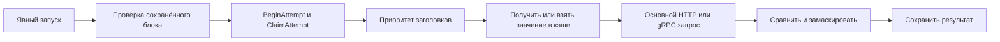

## Context

Мотивация и границы изменения — в [proposal.md](proposal.md), проверяемое поведение — в восьми delta-спецификациях `specs/`. Пользователь подтвердил ручные изображения-эталоны для шагов и вызовов, полную HTTP-форму источника заголовка и выбор режима получения при создании каждого такого заголовка.

Наблюдения по текущему коду, базовый коммит `ca06b55`:

| Область | Текущее состояние и следствие |
|---|---|
| `internal/catalog/model.go`, `validation.go`, `repository.go` | Шаг содержит описание и блоки; отдельного ожидания шага и изображений нет. `SaveCase` использует строгую `ValidateSteps`; пустые описание, ресурс, ожидаемый статус или некорректный JSON блокируют сохранение. |
| `qag.test_cases`, `web/src/App.tsx` | Имя непустое и уникально в папке; создание проходит через диалог имени. Для необязательного ввода достаточно автоматического именования, удалять ограничение БД не требуется. |
| `BlockEditor.tsx`, `CaseEditor.tsx`, `RunView.tsx`, `Results.tsx` | Ресурс — `input` с `datalist`. Вызовы имеют общий класс `call-block`; новые галереи и разделители должны работать также в прогоне и истории. |
| `ResourcesPanel.tsx`, `resources/model.go`, `httpapi/types.go` | Диалог окружения содержит имя, открытые переменные и секреты; описания нет. Переменные и секреты уже версионируются вместе в `environment_versions`. |
| `resources/config.go`, `execution/tls_test.go` | Режимов два: `tls` и `plaintext`. `tls` уже применяет клиентскую пару из `certificate` и секрета `PRIVATE_KEY`; реальные HTTP/gRPC mTLS-проверки есть. Нужны явный режим и совместимость, а не новый транспорт. |
| `service/engine.go`, `resources/prepare.go`, `execution/runner.go` | `Prepare` синхронно выполняется при начале прогона; сетевой вызов происходит после `BeginAttempt` и `ClaimAttempt`. Динамический источник нельзя переносить в `Prepare`: иначе начало прогона или отказ регистрации создадут скрытый запрос. |
| `runs/model.go`, `storage/migrations` | Сценарии и контексты сериализуются в JSONB, ресурсы неизменяемо версионируются; есть миграции `001`–`004`. Новые необязательные JSON-поля не требуют переписывать снимки. |
| `httpapi/server.go`, `web/src/style.css` | API допускает JSON до 32 MiB, проверяет Host/Origin/CSRF; CSP разрешает локальные изображения и data URL, но запрещает inline-script. Цвета CSS заданы литералами; настройки темы нет. |

## Goals / Non-Goals

**Goals:**

- Разделить безопасное сохранение документа и его исполнимость, используя одну серверную проверку готовности.
- Сохранить изображения и поведение старых снимков без файлового хранилища или отдельного сервиса.
- Использовать существующие версии, Vault, регистрацию попыток и отмену для источников заголовков.
- Сделать новые формы и темы согласованными в редакторе, прогоне, истории и встроенном примере.

**Non-Goals:**

- Автоматическое сравнение изображений, OCR, редактор картинок и загрузка эталона по внешнему URL.
- Получение заголовков из gRPC/SQL, цепочки вложенных динамических источников, JavaScript-выражения, автоматическое обновление токена или TTL-кэш.
- Изменение правил первого/успешного прогона, авторизации приложения, поддерживаемых БД или числа одновременных вызовов.
- Физическая очистка изображений и изменение содержимого системного примера.

## Decisions

### 1. Черновик и исполнимость — разные проверки

Разделить текущую валидацию на проверку структуры черновика и проверку исполнимости. Сохранение проверяет допустимые типы полей и протоколов, уникальные служебные UUID, размеры документа и корректность ссылок на изображения. Пользовательские поля не обязательны: отсутствующие HTTP/gRPC/SQL-параметры, ожидаемый статус и частично набранные JSON/typed SQL значения сохраняются. Неверный синтаксис JSON хранится строкой, как и сейчас. Пустые числовые поля допускаются как отсутствие значения, а не теряются при `Number('')`; тайм-аут по умолчанию применяется при выполнении. Ограничения размеров, конфликт revision, архив и `readOnly` действуют независимо от заполненности.

Исполнимость проверяется до сети: полный прогон проверяет весь сценарий, пробный запуск — только выбранный блок. Содержательный ручной шаг имеет описание, ожидаемый текст, изображение или готовый блок; пустой шаг остаётся допустимым черновиком. Введённое имя не является условием исполнения. Замечания возвращаются отдельным `validationIssues` с путями полей и показываются как «Черновик / Не готов к запуску», не как ошибка сохранения. Проверка определения не зависит от текущего окружения; наличие выбранного ресурса, значения переменных и параметры соединения проверяются дополнительно перед запуском. Проверка готовности ничего не вызывает в сети.

При пустом имени `CreateCase`, `SaveCase` и переименование выбирают `Новый тест-кейс`, затем `Новый тест-кейс 2` и т. д. Под существующей блокировкой папки выбрать свободное нормализованное имя, исключая текущий кейс, и записать его в той же транзакции. Архивные имена участвуют в проверке. Непустой явный дубликат остаётся ошибкой. В форме кейса нет `required`; у папок и ресурсов требования к именам сохраняются.

Альтернативы: убрать всю валидацию — потерять целостность; разрешить SQL NULL вместо имени — усложнить сортировку и нарушить текущую модель; держать черновик только в браузере — потерять его после перезапуска.

### 2. Изображения: неизменяемый blob и ссылка в ожидании

Добавить миграцию `005_expected_images.sql` с `qag.expected_images`: UUID, владелец `test_case_id`, исходное имя файла, фактический MIME, размер, ширина/высота, SHA-256, `bytea` и время создания. Ограничения БД проверяют размер и число пикселей с безопасной арифметикой. Один upload создаёт один неизменяемый объект. Дедупликация и физическое удаление не нужны для этого изменения.

В шаг добавить необязательное `expected` с `text` и `images`; в существующую `catalog.Expectation` блока — необязательный массив `images`. Ссылка содержит `imageId` и подпись; порядок задаётся массивом. Метаданные самого файла неизменяемы. Снимки `TestCase` и `safe_request` сохраняют ссылки и подписи выполненной версии. Удаление из текущей галереи удаляет только ссылку, поэтому прежние прогоны и пробные попытки продолжают работать. Нет сборщика мусора, который мог бы удалить blob, встречающийся лишь в старом JSON-снимке.

Предложенные API:

| Маршрут | Назначение |
|---|---|
| `POST /api/v1/test-cases/{id}/images` | JSON `{filename, dataBase64}`, один файл, ответ с ID и проверенными метаданными |
| `GET /api/v1/test-cases/{id}/images/{imageId}` | Байты с фактическим `Content-Type`, `nosniff` и безопасным inline-показом |
| Существующий `PUT /test-cases/{id}` | Атомарное сохранение ссылок/подписей с проверкой владельца, количества и revision |

JSON upload выбран из-за действующей JSON/CSRF-обёртки: 10 MiB в base64 укладываются в лимит 32 MiB. Вложения не встраиваются base64 в сценарий или снимок. Проверять размер до декодирования, `DecodeConfig` и число пикселей до полной проверки изображения; принимать только PNG, JPEG и WebP. PNG/JPEG поддерживаются стандартными Go-декодерами; для WebP добавить закреплённую совместимую зависимость `golang.org/x/image/webp`, предоставляющую [декодирование и чтение размеров](https://pkg.go.dev/golang.org/x/image/webp). Обслуживать только байты прошедшего проверку формата, не доверять расширению или клиентскому MIME.

Загрузка требует существующего редактируемого кейса: автоматически создаваемое имя позволяет получить ID сразу. Просмотр разрешён архиву и истории. После незавершённого редактирования неиспользованный upload может остаться в БД; это сознательная цена сохранности снимков. Галерея показывает загрузку, ошибку и увеличенный просмотр с клавиатурным закрытием; локальный предпросмотр использует data URL, разрешённый существующей CSP. Автоматический comparator не читает `images`.

Альтернативы: файлы рядом с бинарником усложняют backup; base64 в каждом снимке размножает данные; изменяемый общий файл разрушает воспроизводимость старой истории.

### 3. Метаданные окружения и переменные редактируются отдельно

Добавить `006_environment_description.sql`: `qag.environments.description text NOT NULL DEFAULT ''`. Описание — текущие метаданные окружения, не секрет и не источник подстановок. Существующим записям присваивается пустая строка без изменения переменных и шифротекста.

`POST /environments` принимает имя и описание и создаёт пустую версию переменных. `PUT /environments/{id}` обновляет только эти метаданные с revision. Добавить `PUT /environments/{id}/variables` для `{revision, variables, secrets}`: обновление создаёт новую `environment_versions`, сохраняя не заменённые секреты через существующий `SecretChanges`. Любая операция увеличивает общий revision и защищена от конфликтов. GET сохраняет доступ к открытым переменным и именам секретов.

На странице окружения разместить две рабочие секции «Ресурсы» и «Переменные» с действиями добавления/редактирования. Диалог создания и настройки метаданных содержит только имя и описание. Открытая переменная редактируется по имени и значению; секретная показывает факт наличия, явные замену и удаление. Существующие значения не переносятся в браузер и не пропадают при сохранении метаданных. Встроенное окружение остаётся read-only для обеих секций. Обновить все внутренние потребители старого контракта и E2E, создававшие переменные вместе с окружением.

Альтернативы: новый вид протокольного ресурса «переменная» смешивает подключения и значения; оставить переменные в модальном окне не выполняет запрос пользователя; разнести значения по отдельным неверсионируемым строкам нарушит существующий контекст прогона.

### 4. Явный mTLS с совместимостью старых версий

Расширить `TLSConfig.mode` значением `mtls`. Для HTTP считать `https` совместимым с `tls` и `mtls`. В mTLS обязательны клиентский сертификат и сохранённый/новый секрет `PRIVATE_KEY`; проверка CA, hostname и пары остаётся в существующем TLS-конструкторе. PostgreSQL получает тот же проверенный TLS config через pgx. Отдельно проверить реальный PostgreSQL mTLS на выделенной тестовой цели.

Legacy-конфигурация `mode=tls` с клиентской парой продолжает использовать пару при выполнении старого снимка; форма распознаёт её как mTLS и при следующем сохранении пишет явный режим. Не обновлять старые `resource_versions`, associated data или зашифрованные ключи миграцией. Новый обычный TLS не подмешивает клиентскую пару автоматически; переход между режимами требует явного решения о сохранении/очистке ключа и не стирает секрет молча.

При выборе обычного TLS/plaintext клиентский сертификат исключается из активной конфигурации, а сохранённый приватный ключ может остаться неактивным секретом. Его наличие само по себе не включает mTLS и не делает plaintext недопустимым. Legacy-режим определяется по наличию клиентского сертификата в старом TLS config; для новых записей клиентская пара сохраняется только с явным `mtls`.

Альтернативы: только переименовать пункт TLS — сохранить непонятный ввод; переписать все прежние версии на mTLS — нарушить неизменность снимков.

### 5. Модель заголовка и HTTP-источника

Ввести отдельный `RequestHeader`, сохранив совместимость `{name,value}` для статического значения. Динамический вариант содержит стабильный ID настройки и `source`: HTTP-метод, абсолютный URL, query, статические заголовки, режим/тело запроса, собственный TLS config, `privateKeySecret`, `jsonPointer`, `prefix`, `fetchMode=per_attempt|per_run`. Он используется в HTTP request headers, gRPC metadata и общих заголовках HTTP/gRPC-ресурса. Query, ожидаемые и фактические заголовки остаются прежними `KeyValue`; источник не становится универсальным значением для любого поля.

URL может содержать исходные query-параметры; дополнительные пары дополняют их предсказуемо без скрытого удаления. Разрешены только http/https, без userinfo и fragment. Заголовки самого источника — только статические значения и ссылки на переменные/секреты: рекурсивных HTTP-источников нет. Полнота ресурсной настройки проверяется при сохранении ресурса; неполная настройка в кейсе сохраняется как черновик.

Новый общий `HeaderEditor` показывает переключатель «Значение / Из HTTP-запроса», полную HTTP-форму, поле JSON, префикс (например, `Bearer `) и оба режима получения. Источник не требует отдельного ресурса. Его TLS/mTLS настраивается независимо; `privateKeySecret` ссылается на секрет владельца-ресурса или окружения. Для разных клиентских пар используются разные имена секретов. В TLS-конструктор передаётся только ключ выбранного соединения, а не чужой `PRIVATE_KEY` из общей карты.

Выбор поля — [JSON Pointer RFC 6901](https://www.rfc-editor.org/rfc/rfc6901): `/data/access_token`, `/tokens/0/value`, экранирование `~1` и `~0`. Это обеспечивает однозначный синтаксис без языка выражений. Декодирование использует точные JSON-числа; отсутствующее поле, `null`, коллекция или недопустимый результат дают безопасную ошибку. Префикс конкатенируется без вычисления кода; после этого проверяются CR/LF и применимость HTTP/gRPC-заголовка.

Альтернативы: `jq`/JavaScript добавляют исполнение выражений; отдельный обязательный HTTP-ресурс усложняет указание URL; изменение универсального `KeyValue` разрешило бы источники в query и ожидаемых заголовках.

### 6. Выполнение источника после регистрации попытки

Сохранить `Prepare` чистой функцией: там проверяются параметры, ссылки, обычные подстановки и структура источника, но не выполняется HTTP. Секретные ссылки разрешить также в теле HTTP-источника (нужны для POST получения токена); URL/query и тело основного запроса сохраняют прежние ограничения. Подготовленный объект с расшифрованными значениями существует только в памяти; `safe_request` маскирует их до записи.

Порядок одной попытки:

Расширить Runner стадией разрешения эффективных заголовков до прикладного вызова. Case-insensitive приоритет блока над ресурсом применяется также при статической подготовке, до проверки подстановок: источник подавленного заголовка не вызывается и не блокирует подготовку своей неиспользуемой переменной. Все известные ошибки эффективных источников проверяются до первого из их запросов. Источники выполняются последовательно в порядке эффективных заголовков, затем основной запрос. Для gRPC полученные метаданные подготавливаются до обращения к reflection и передаются прикладному методу. Один `context.WithTimeout` охватывает все источники и основной запрос. Транспорт источника не следует redirect, не повторяет запрос автоматически, ограничивает ответ 5 MiB и принимает только 2xx + полный JSON. При ошибке основной вызов не выполняется. SQL-адаптер не получает динамические заголовки.

`StartRun`, GET и валидация не выполняют источники. Повтор `Idempotency-Key` возвращает существующую попытку. Повтор записи результата после отказа PostgreSQL повторяет только запись, а восстановление после падения оставляет `interrupted` без повторного HTTP-источника. Существующие четыре глобальных слота и одна активная попытка прогона не меняются.

Альтернативы: получение в `Prepare` создаёт скрытые обращения при начале прогона; отдельный пользовательский прогон для токена меняет историю; HTTP-источник до `BeginAttempt` нарушает правило устойчивого начала внешнего эффекта.

### 7. Кэш — локальный для конкретного прогона

`per_attempt` всегда получает значение заново при новой команде. `per_run` сохраняет первый успешный результат в памяти Engine/Runner по `(runID, bindingID, digest зафиксированной настройки)`. Общий заголовок ресурса имеет один bindingID для всех использующих его блоков; настройки отдельных заголовков не смешиваются. Использовать существующее ограничение одной выполняющейся попытки прогона и защитить карту от гонок. Ошибки не кэшируются; следующая явная попытка может повторить получение. Истёкший токен не обновляется скрыто.

У пробного вызова область — `attemptID`, поэтому оба режима получают новое значение для каждой новой пробной попытки. Новый прогон всегда получает новую область. Освобождать кэш после успешных `FinishRun`, `CancelRun` и завершения Engine; при неудавшейся записи завершения не уничтожать область ещё активного прогона. Перезагрузка браузера при живом backend не теряет кэш. После перезапуска backend прежние незавершённые прогоны уже становятся `interrupted`, поэтому сохранять токен в БД ради продолжения не требуется.

Альтернативы: глобальный кэш переносит токен между окружениями и прогонами; сохранение динамического токена в БД добавляет секретное хранилище без нужды продолжать прерванный прогон; получать при старте прогона нарушает явный запуск.

### 8. Маскирование и диагностика источников

После извлечения добавить значение и итог с префиксом в секреты redactor до основного запроса. В рамках прогона учитывать также уже использованные значения, чтобы отражённый ранее полученный токен не утёк в следующей попытке. Маскировать результат, headers/trailers, ошибки и comparison differences теми же средствами, которые уже учитывают JSON-экранирование. Не сохранять тело ответа источника или секретную кэш-карту.

В результат добавить безопасную диагностику: имя/ID настройки заголовка, режим, `fetched/reused/error`, HTTP-статус источника при наличии, длительность, безопасный код ошибки и факт отправки основного запроса. История показывает конфигурацию из снимка и эту диагностику, не полученное значение. Ошибки транспорта не должны включать расшифрованное тело или реквизиты. Не добавлять отдельный автоматический «тест источника» при открытии формы.

Альтернатива — показывать полный ответ токен-сервиса — раскрывает значения, которые должны оставаться секретными, и не нужна для сравнения основного вызова.

### 9. Тема, селекторы и разделение блоков

Вынести цвета `style.css` в семантические CSS-переменные: фон, поверхность, граница, основной/вторичный текст, focus, протоколы, состояния и diff. Добавить светлую и тёмную палитры и `color-scheme`. Предпочтение `light|dark|system` хранится под отдельным ключом localStorage, не смешивается с окружением и кейсом; системный режим использует [prefers-color-scheme](https://developer.mozilla.org/en-US/docs/Web/CSS/@media/prefers-color-scheme). Небольшой внешний same-origin bootstrap-скрипт в head применяет выбранную тему до CSS/первого показа, не ослабляя действующий запрет inline-script в CSP. При недоступном localStorage переключение остаётся рабочим в текущей вкладке.

Заменить `datalist` на `<select>`: пустой вариант, совместимые ресурсы с сортировкой, отдельный недоступный вариант для сохранённого отсутствующего имени. Смена окружения или ввод `RESOURCE/path` не должны молча выбирать другой ресурс; ссылка обновляет селектор только на соответствующее имя либо остаётся явно неразрешённой в черновике.

Для каждого `call-block` задать самостоятельную рамку/разделитель и отступ, заголовок с номером и протоколом; запрос, ожидание и ответ разделить подписанными секциями. Применить одинаковое оформление в редакторе, `RunView` и `Results`, включая историю и галереи. Проверить различимость линий, фокуса, disabled-состояний, ошибок и таблиц в обеих темах. Переключение темы не перемонтирует редактор и не очищает его состояние.

Альтернативы: CSS invert и массовое понижение прозрачности искажают изображения и статусы; разные реализации селектора в редакторе и источнике разойдутся по поведению; только цвет протокола не отделяет два вызова одного типа.

### 10. Проверочные цели остаются изолированными

Расширить `internal/testfixture` и `cmd/testfixture` HTTP-источником с управляемыми JSON-ответами, статусами, задержками, отражением заголовка и счётчиками обращений. Счётчики источника и основного сервиса различаются: ими проверяются оба режима, переопределение, повторы и отсутствие основного запроса при отказе. Использовать уже существующие отдельные CA/клиентские пары для HTTP/gRPC и добавить вариант разных сертификатов источника и цели.

Для PostgreSQL mTLS добавить отдельную тестовую Docker-цель на той же закреплённой версии PostgreSQL, что и Compose. Helper создаёт уникальный временный контейнер, случайный loopback-порт и собственные PKI/pg_hba для обязательного клиентского сертификата, затем удаляет только свои объекты. Он не меняет SSL, роли и конфигурацию действующих `qag-postgres-1` и `qag-postgres-test-1`. Интегрировать цель в тестовый скрипт с ограниченным ожиданием готовности и гарантированной очисткой. Это инфраструктура проверок, не дополнительная зависимость обычного запуска.

## Risks / Trade-offs

- [Черновик можно ошибочно исполнить] → отдельные серверные проверки полного прогона и выбранного блока до любой сети; UI только отображает те же замечания.
- [Смена контракта окружений удалит переменные] → отдельные metadata/variables DTO, перенос старых данных без расшифровки и тест редактирования только описания.
- [Изображения увеличивают БД] → лимиты байтов, пикселей и галереи, один blob вместо копий в снимках; физическая очистка сознательно не входит в изменение.
- [Новый mTLS нарушит старый TLS с сертификатом] → совместимый reader старого режима и проверки реальных HTTP/gRPC/PostgreSQL-соединений и прежних снимков.
- [Источник с POST имеет внешний эффект] → устойчивое начало попытки, отсутствие автоматических повторов и диагностируемый неопределённый результат после прерывания, без обещания отката внешнего сервиса.
- [Кэш перепутает токены] → ключ включает runID и конкретную зафиксированную настройку; новая попытка редактора и новый прогон изолированы, terminal cleanup проверяется отдельно.
- [Динамическое значение утечёт через отражённый ответ] → redactor получает извлечённое и итоговое значения до основного вызова; тесты проверяют также сохранённый JSONB, ошибки и escaped JSON.
- [Тёмная тема скроет детали] → семантические палитры и Chromium-проверки основных экранов/диалогов, подписанные границы вместо одного цвета.

## Migration Plan

1. Перед применением сохранить согласованный PostgreSQL-backup и мастер-ключ. Проверить обновление на выделенной заполненной БД; рабочие данные при планировании не изменять.
2. Добавить миграции `005`/`006`, не менять checksum `001`–`004`. Новые JSON-поля читать как необязательные; старые статические заголовки, TLS и снимки обслуживать совместимо.
3. Обновить Go DTO, API, `cmd/contract` и TS-типы вместе. Разделить валидацию и операции окружения, добавить storage/API изображений, затем исполнение и UI. Исправить внутренние fixtures и проверки старого save-поведения согласно новым требованиям.
4. Выполнить unit/component, PostgreSQL integration, реальные mTLS-цели, backup/restore и Chromium-сценарии с подсчётом сетевых эффектов. Пройти обычный встроенный пример и прежние сценарии истории.
5. Пересобрать встроенный UI, проверить готовый бинарник и общий `scripts/verify.ps1`; записать результаты и новые формы в документацию. Этот proposal создаёт только планировочные артефакты; реализация начинается отдельным apply.

Откат на предыдущий бинарник после применения новых миграций выполняется восстановлением копии до обновления в отдельную БД с исходным ключом и подготовленной demo-ролью. Не удалять изображения, новые колонки или записи миграций из рабочей БД ради запуска старой версии.
