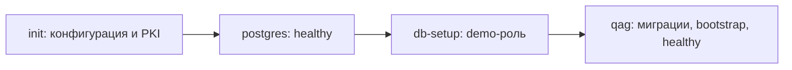

## Context

Мотивация — в [proposal.md](proposal.md). Проверены Compose, README, эксплуатационная инструкция, PowerShell-скрипты, runtime-конфигурация, HTTP-защита, demo bootstrap, PKI и экспорт.

- Сейчас `compose.yaml` содержит только PostgreSQL 18.6, том `qag_postgres-data` и loopback-порт 15432. TLS-файлы берутся из `.local/pki`; приватный CA-ключ PostgreSQL не получает.
- `scripts/init-local.ps1` сохраняет пароль, мастер-ключ и динамически именованную demo-роль в `.local/dev.env`. Значения повторно используются; их замена нарушит доступ к существующему тому и секретам.
- `internal/runtime/config.go` отклоняет `0.0.0.0`. HTTP-защита выводит допустимые Host/Origin из порта listener. Контейнерный listener и опубликованный порт хоста требуют явного разделения.
- `cmd/qag` уже обрабатывает SIGTERM, миграции, блокировку экземпляра и readiness. `demo.Bootstrap` сейчас получает URL непосредственно из `listener.Addr()`, что непригодно при wildcard-listener. `cmd/demo-setup` подготавливает отдельную роль до старта приложения.
- `web.Assets` встраивает готовый `web/dist`. Windows-сборка создаёт `.syso`; в Linux он не нужен. Существующие generated protobuf bindings находятся в репозитории.
- Linux-backend уже сообщает `clipboardNative=false`; `ExportDialog` выбирает browser HTML clipboard по возможности сервера. PDF, текст и Markdown не требуют Windows. Нативный clipboard хоста недоступен контейнеру.
- Makefile и Dockerfile отсутствуют. GNU Make локально не обнаружен, поэтому прямой Compose-путь обязателен и не должен зависеть от Make.

Нынешние требования запрещают любой listener вне loopback. Это ограничение уточняется в двух delta-разделах: нативный режим сохраняет прежнюю границу, контейнерный допускает общий HTTP-listener при локальной публикации на хосте.

## Goals / Non-Goals

**Goals:**

- Одна команда Compose для новой установки, без языковых инструментов на хосте.
- Один постоянно работающий qag и один PostgreSQL; повторяемая подготовка до readiness.
- Совместимость существующего тома, мастер-ключа, demo-идентификаторов, истории и тестовых схем.
- Общая реализация runtime-проверок для контейнерного и нативного режимов, без копирования серверной логики в shell.

**Non-Goals:**

- Авторизация, LAN/публичное размещение, reverse proxy, Kubernetes, публикация образа в registry и CI/CD.
- Изменение схемы БД, автоматическая ротация секретов, произвольная миграция внешних PostgreSQL-установок.
- Контейнеризация всего Windows/Word E2E-стенда и создание второго тестового PostgreSQL.
- Проброс системного clipboard Windows в Linux-контейнер или установка отдельного агента на хост.

## Decisions

### 1. Многоэтапная сборка и небольшой Linux-runtime

Dockerfile содержит стадии Node для `npm ci`/production UI и Go для Linux-бинарников. Версии инструментов соответствуют `go.mod` и `web/package-lock.json`/README: Go 1.26 и Node 24; конкретные поддерживаемые теги фиксируются при реализации и проверяются сборкой. UI копируется в Go-стадию до `go build`, чтобы шрифты, favicon и license-файлы вошли в embed. Использовать `CGO_ENABLED=0` и архитектуру сборки Docker. Применённые миграции и generated bindings брать из репозитория.

Финальный runtime — Debian slim с CA-сертификатами и непривилегированным пользователем, без Go, Node и исходников. Подготовительный target содержит небольшой Go-инструмент для init/import/export и повторно использует имеющиеся пакеты настройки роли/PKI. Сам qag запускается напрямую как основной процесс контейнера; отдельный healthcheck-режим выполняет локальный GET `/api/v1/health`, поэтому curl не требуется.

`.dockerignore` исключает `.git`, `.local`, `.tools`, `.cache`, env-файлы, дампы, `dist`, `web/dist`, `node_modules`, тестовые отчёты и `.syso`. Сборка генерирует собственный UI; секреты не передаются в build args. Вариант копирования готового `dist/qag.exe` исключён из-за Windows-формата и зависимости от локальной сборки.

### 2. Постоянное состояние без обязательного host env-файла

Новая установка использует именованные тома. Отсутствующая `.local/dev.env` не должна мешать разбору Compose: обязательной интерполяции секретов из этого файла больше нет.

| Том | Назначение | Доступ |
|---|---|---|
| `postgres-data` | Прежняя физическая PostgreSQL-БД | PostgreSQL RW; init проверяет наличие данных RO |
| `runtime-config` | JSON-конфигурация, мастер-ключ, рабочие/demo-реквизиты | init/import RW; qag и provisioner RO |
| `private-pki` | CA и приватный ключ для подготовки/тестовых сертификатов | Только инструменты подготовки/экспорта |
| `postgres-config` | Пароль PostgreSQL, CA-сертификат, серверная пара и HBA | init RW; PostgreSQL RO |

Источник реквизитов — один атомарно записываемый документ `runtime-config`; производные файлы создаются из него, признак завершённой подготовки появляется последним. Повторный init проверяет согласованность и не меняет ключи. При обнаружении существующих данных PostgreSQL без исходной конфигурации init останавливается до генерации пароля и ключа. Частичное либо повреждённое состояние не заменяется новой конфигурацией.

Путь к документу задаётся через `QAG_CONFIG_FILE`. При его отсутствии сохраняется прежняя загрузка из окружения; явно заданные переменные процесса переопределяют корректно загруженные значения файла, что нужно для портов и тестовых namespaces. Указанный, но нечитаемый или невалидный файл вызывает отказ, а не незаметный fallback. Проверки ключа, DSN и namespace остаются общими.

PostgreSQL читает пароль через `POSTGRES_PASSWORD_FILE`. Его контейнер получает только `postgres-config`, включая публичный CA и собственный ключ; мастер-ключ qag и приватный CA ему не передаются. Сохраняется текущая подготовка server key с владельцем postgres и режимом 0600. Runtime-конфигурация qag доступна пользователю приложения только для чтения. Чувствительное содержимое не печатается в логах и Make-рецептах.

Это устраняет зависимость чистого запуска от PowerShell и от владельца bind-mounted env-файла на Linux. Хранение единственного мастер-ключа в эфемерной файловой системе контейнера отвергнуто из-за потери доступа к секретам при пересоздании.

### 3. Порядок Compose и состояние готовности

Основные сервисы:

`init` и `db-setup` — одноразовые операции. Для их завершения использовать `service_completed_successfully`, для PostgreSQL — `service_healthy`; readiness qag проверяется отдельно. Контейнер runtime имеет разумный start period для миграций. `restart: unless-stopped` относится к постоянно работающим сервисам; ошибку подготовки не скрывать бесконечной генерацией конфигурации.

`docker compose up --build -d --wait` запускает новую установку целиком. `docker compose up ... postgres` поднимает только БД и необходимые зависимости для нативной разработки. Роль `qag_test_mtls`, ограничения HBA и один физический сервер сохраняются. `down` не содержит `--volumes`; qag получает SIGTERM напрямую и достаточный `stop_grace_period` для завершения.

Порядок ожидания подтверждён [документацией Compose](https://docs.docker.com/compose/how-tos/startup-order/). Обычного короткого `depends_on` недостаточно для ожидания готовности БД.

### 4. Явный сетевой режим и отдельный публичный адрес

Добавить `QAG_NETWORK_MODE=container` и `QAG_PUBLIC_ORIGIN`. В нативном режиме оставить loopback по умолчанию и отклонение wildcard-адресов. В контейнерном — `QAG_ADDRESS=0.0.0.0:8080`; Compose публикует `127.0.0.1:${QAG_HTTP_PORT:-8080}:8080`.

`QAG_PUBLIC_ORIGIN` выводится из опубликованного порта и проходит строгую проверку локального HTTP-origin без пути, userinfo, query и fragment. HTTP-server допускает внутренний loopback authority для healthcheck и явно настроенные локальные authority/origin внешнего порта. Допустимые `localhost`/loopback-алиасы должны относиться к тому же опубликованному порту. Сохранить CSRF, `Sec-Fetch-Site`, CSP и отказ постороннему Host/Origin. `X-Forwarded-*` не расширяет allowlist.

Настройка адреса публикации обязательна: [Docker по умолчанию публикует порт на всех интерфейсах](https://docs.docker.com/get-started/docker-concepts/running-containers/publishing-ports/). В этой версии настраивается номер порта, а host IP штатного Compose остаётся `127.0.0.1`.

### 5. Demo-адреса и обращения к ресурсам

Для системного HTTP-ресурса вычислять клиентский loopback URL внутри контейнера: `http://127.0.0.1:8080/demo/v1`, независимо от wildcard listener и внешнего порта. gRPC остаётся `127.0.0.1:9091` внутри qag и не публикуется. SQL использует DNS-имя сервиса `postgres:5432`, ту же БД `qag` и сохранённую ограниченную demo-роль. Существующий bootstrap создаёт новую версию изменившегося системного ресурса без смены ID и старых снимков.

Пользовательские ресурсы автоматически не переписывать: `127.0.0.1` теперь означает контейнер qag. README объясняет `host.docker.internal` для ресурсов хоста, доступность адреса сервиса для Docker и Linux host-gateway mapping. Внешние адреса, сертификаты и proxy-настройки требуют обычной конфигурации пользователя. Тест встроенного примера обязан выполнить все три протокола из контейнера, а не ограничиться загрузкой HTML.

### 6. Импорт прежней установки и нативная разработка

Сохранить Compose project name `qag`, имя сервиса `postgres` и существующий `postgres-data`, поэтому используется прежний `qag_postgres-data`. До перехода остановить нативный qag и сделать backup БД вместе с ключом. Предусмотреть служебный профиль `tools` с операцией `import-local`: исходная `.local` монтируется RO с запретом автоматически создавать отсутствующий bind path; приватные тома — RW. Импорт запускается без зависимостей, до обычного `up`.

Импортировать исходные пароли, мастер-ключ, имя demo-роли и PKI. Переводить поддерживаемые локальные PostgreSQL URL на `postgres:5432` только в контейнерной конфигурации, сохраняя базу и реквизиты. Проверять согласованность пароля в URI/локальном файле, форматы ключа и PKI. Произвольные внешние DSN, несовместимые TLS-пути или конфликт уже подготовленного состояния отклонять с объяснением; TLS не понижается автоматически. Исходные `.local`-файлы остаются нетронутыми. Переход существующего активного прогона требует его завершения/отмены перед остановкой приложения.

Скрипты `init-local.ps1`/`database.ps1` согласовать с новым источником конфигурации. При переходе от контейнерного запуска к нативному предоставить экспорт тех же реквизитов и PKI средствами служебного контейнера и Docker copy, с записью приватных файлов средствами PowerShell без вывода содержимого. Не генерировать второй ключ для уже существующего Docker-состояния и не перезаписывать конфликтующий host env-файл. Нативные build/run-скрипты остаются инструментами разработки с Go/Node на хосте.

### 7. Makefile, README и резервные копии

Makefile содержит `.PHONY`-цели `help`, `init`, `build`, `up`, `down`, `restart`, `logs`, `ps`, `import-local`; по умолчанию выполняется `help`. Рецепты используют Docker CLI, без `rm`, `sed`, Bash-подстановок или обязательного PowerShell. `QAG_HTTP_PORT` экспортируется GNU Make как обычная переменная окружения; `make up QAG_HTTP_PORT=18088` должен соответствовать прямому Compose-варианту. `up` выполняет build и ожидает healthy; `init` подготавливает состояние без запуска приложения. `import-local` использует тот же образ инструментов. Ошибки возвращаются напрямую.

В начале README разместить прямой Compose quick start, затем Make-вариант, смену порта и переход прежней установки; отдельно оставить разработку на Windows. Указать Docker/Compose как обязательные инструменты, GNU Make как необязательный, ожидаемый URL и действия при занятом порте 8080. Секретные значения в примерах отсутствуют.

Backup новой установки включает PostgreSQL dump и отдельную приватную конфигурацию/PKI из томов. Описать команды Docker для копирования готовых файлов через служебный контейнер, без Go/Node на хосте и без текстового перенаправления бинарного дампа. `scripts/backup.ps1` должен брать фактический ключ новой установки, сохраняя поддержку прежнего env-файла и отказ перезаписывать существующую копию. При restore использовать исходные ключи; проверять расшифровку, эталоны и историю. Linux-backend использует уже реализованный browser HTML clipboard; документация отделяет его от native RTF/Windows clipboard, недоступного из контейнера.

### 8. Проверки без второго тестового PostgreSQL

Чистую и повторную генерацию состояния, обнаружение существующей БД без конфигурации, частичные записи и конфликт импорта проверить на изолированных файловых fixture. Dockerfile строится из чистого build context; образ проверяется на embedded assets, UID и отсутствие приватных данных. Compose проверяется на отсутствие обязательной host env-интерполяции, граф зависимостей и публикацию портов.

Для контейнерных integration/smoke использовать существующий PostgreSQL и стандартный fixture с уникальными app/demo/target-схемами и ограниченными ролями. Тестовый override направляет qag-контейнер на это пространство; готовый fixture заменяет эксплуатационные init/provision операции, а работающий основной экземпляр сохраняет собственную блокировку и данные. Не добавлять `postgres-test` или отдельную тестовую БД. Проверить HTTP/CSRF на обычном и другом опубликованном порту, три протокола, persistence/recreate, SIGTERM и отсутствие автоматического повтора вызовов.

Полный эксплуатационный Compose-переход проверить на прежнем томе только после backup и остановки нативного процесса, сохранив возможность отката. Доказательства новой установки складываются из проверки пустого состояния, реальных миграций пустого тестового namespace, проверки dependency graph и прохождения контейнерного приложения; рабочий PostgreSQL для проверки не очищается.

## Risks / Trade-offs

- [Новый ключ при старом PostgreSQL-томе сделает секреты недоступными] → Проверка наличия данных до генерации, явный импорт и тест конфликтов/повторной подготовки.
- [Listener доступен контейнерной сети, а публичный порт отличается] → Явный сетевой режим, локальный port mapping и отдельный проверяемый origin; негативные Host/Origin/CSRF-тесты.
- [Пути и localhost существующих ресурсов означают другое окружение] → Менять только системные runtime-подключения, сохранить пользовательские версии и описать host addressing.
- [Приватная конфигурация потеряется при обслуживании Docker] → Именованные тома, отсутствие удаления volumes в Makefile и инструкция отдельного backup ключа/PKI.
- [Make различается на Windows и Linux] → Рецепты ограничены Docker CLI; проверить `make -n` и реальные команды, оставить прямой Compose-путь.
- [Контейнер не владеет Windows clipboard] → Существующая capability сервера выбирает browser HTML clipboard; проверить его и PDF/текст из браузера хоста, сообщать фактическую неподдержку без ложного успеха.

## Migration Plan

1. Добавить образ, подготовку постоянного состояния и контейнерный сетевой режим, сохранив нативные defaults.
2. Обновить Compose и Makefile; проверить сборку, конфигурацию и контейнерный smoke на изолированных схемах единственного PostgreSQL.
3. Для существующей установки сохранить backup, остановить нативный процесс, выполнить импорт прежней `.local`-конфигурации и обычный Compose `up` без удаления томов.
4. Проверить URL, readiness, встроенный пример, секреты и историю; обновить README и эксплуатационные инструкции по фактическим командам.
5. Для отката остановить контейнер qag, сохранить PostgreSQL и вернуться к прежнему бинарнику с исходным env/ключом. При изменениях данных после перехода использовать актуальный согласованный backup; тома не удалять.
